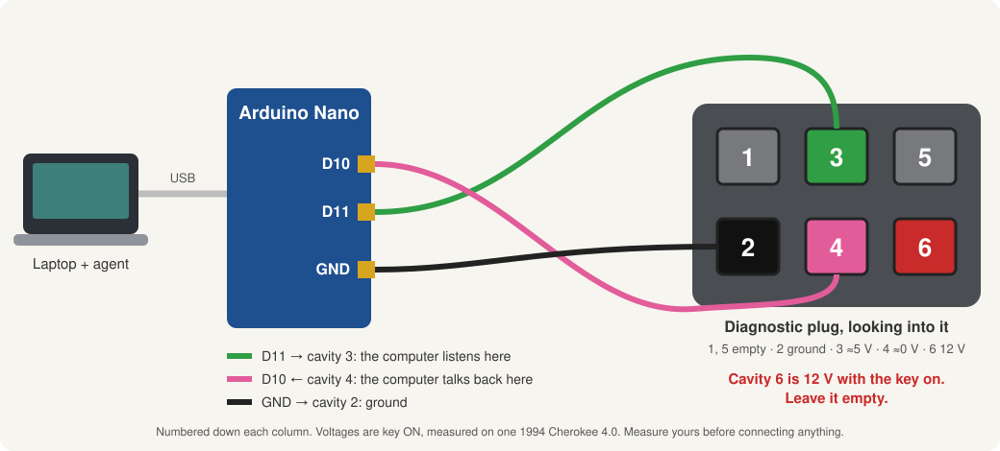
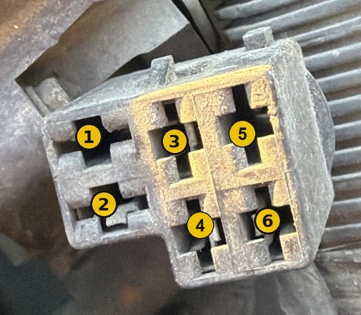

# xj-scanner

Read the engine computer of a 1991–95 Jeep from a laptop, and let an AI agent do the reading.

Three wires go from the diagnostic plug under the hood to a $3 Arduino Nano. The Nano plugs into your laptop over USB. From there Claude Code, Codex or any coding agent can read fault codes and live engine data, log a drive, and run the computer's built-in tests.

It was built and tested on one car: a **1994 Jeep Cherokee XJ, 4.0L, engine computer 56030117**. Other 1991–95 Chrysler/Jeep computers of this family (SBEC, OBD1) should be close, but measure your own plug before you connect anything.



## The easy way

1. Clone this repo and open it in Claude Code, Codex or another coding agent.
2. Say: **"Help me hook this up to my Jeep."**

The agent reads [AGENTS.md](AGENTS.md) and walks you through it one step at a time: the software, the breadboard, finding the right holes in the plug with a meter, and the first reading. Ask it to explain anything in simpler words.

## What you need (about $15)

- Arduino Nano clone (5 V, USB-C or mini-USB) and its cable
- Small breadboard and a few jumper wires
- Three wires long enough to reach from the plug to where the laptop sits
- Three 1/4" male spade terminals (they push into the plug)
- A multimeter

## The one thing to get right

**Cavity 6 is 12 volts with the key on. Never connect anything to it.** On the test car its wire is the same black/white as the ground wire, so don't go by color. Check every cavity with a meter first; [docs/connector.md](docs/connector.md) has the measurements to expect.



## Doing it by hand

```sh
python3 -m venv .venv && .venv/bin/pip install -r pc/requirements.txt
.venv/bin/python pc/xj_scan.py --cli DEMO       # a simulated Jeep, to check your laptop side works

brew install arduino-cli && arduino-cli core install arduino:avr
arduino-cli compile --upload -p /dev/cu.usbserial-XXXX --fqbn arduino:avr:nano:cpu=atmega328old arduino/xj_bridge

.venv/bin/python pc/xj_scan.py --cli auto       # key ON: fault codes, then live data logged to pc/logs/
```

Wiring, the breadboard layout and troubleshooting are in [docs/](docs/).

## What's in here

| Folder | What |
|---|---|
| `arduino/` | The Nano sketch (`xj_bridge`) and a wiring debug sketch (`xj_sniff`) |
| `pc/` | The scanner: `xj_scan.py` (fault codes, live data, logging, actuator tests) |
| `tools/` | Small helpers: summarize a log, sweep every parameter, check the computer's part number |
| `docs/` | The plug, the wiring, the protocol, every parameter and its scaling, troubleshooting |
| `.claude/skills/` | Step-by-step playbooks an agent follows with you |

## Credits and license

Parameter IDs, scaling formulas, the OBD1 message sequence and fault code text come from [ChryslerScanner](https://github.com/laszlodaniel/ChryslerScanner) by László Dániel (GPLv3). The fuel-trim scale was settled from the disassembled SBEC code in [AR1972/jeep_2.5L](https://github.com/AR1972/jeep_2.5L). This repo is GPLv3 as well.

This is a hobby project. It talks to your engine computer; you use it at your own risk.
