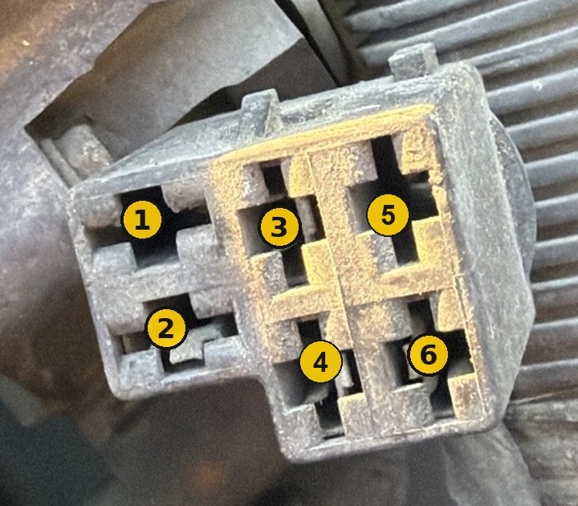

# The diagnostic plug

A 6-cavity plug under the hood, near the engine computer. It is the only connection this project uses.

## Numbering

Numbered **down each column**, looking into the plug: 1 and 2 on the left, 3 and 4 in the middle, 5 and 6 on the right. This is this project's own numbering (it matches the video and the photo above). A factory cavity map for the 1994 plug was not found, so do not assume it matches any diagram online.

## What each cavity is (measured on the test car)

All voltages are measured to battery negative with a multimeter on DC volts.

| Cavity | Position | Wire color | Key ON | What it is | Connects to |
|---|---|---|---|---|---|
| 1 | top left | none | – | empty | nothing |
| 2 | bottom left | black/white | 0 V | **ground** (beeps to battery −) | Nano GND |
| 3 | top middle | green | about 5 V | **PCM receive**: the computer listens here | Nano D11 |
| 4 | bottom middle | pink | about 0 V, and stays 0 V while the key turns on | **PCM transmit**: the computer talks back here | Nano D10 |
| 5 | top right | none | – | empty | nothing |
| 6 | bottom right | black/white | **12 V** | switched 12 V | **nothing, ever** |

Things that caught us out:

- **Cavity 6 has the same black/white wire color as the ground in cavity 2.** Color tells you nothing here.
- **Cavity 6 also beeps on a continuity test with the key off** (through whatever it powers). A beep to ground is not proof of ground. Confirm ground as 0 V with the key ON.
- The original hookup notes expected two 12 V cavities. The test car has one.
- The 5 V on cavity 3 is a data line, not a supply. Don't power anything from it.

## How to identify the cavities on another car

Do this before any wire goes into the plug. Key OFF to start.

1. Black meter lead on battery negative (or a clean engine ground). Meter on DC volts, 20 V range.
2. Turn the key ON (engine off). Touch the red lead into each cavity that has a metal terminal and write down the voltage.
3. Expect exactly this pattern: one cavity near 0 V that also has continuity to battery negative (ground), one near 5 V (PCM receive), one near 0 V that is *not* ground (PCM transmit), and one or two at battery voltage (leave empty).
4. Tell the two 0 V cavities apart: with the key OFF, the ground cavity beeps to battery negative. Then watch the other one while turning the key ON. **If it jumps to about 12 V for a second or two** (the fuel pump prime), it is not the transmit line. Don't connect to it.
5. If you don't get this pattern, stop. Your plug is different from the test car's.

With the scanner connected and the key ON, the transmit line idles LOW (the scanner reports `line idles LOW: looks right for OBD1 with the key ON`). If it reports HIGH, the key is off, wires on cavities 3 and 4 are swapped, or the terminal in cavity 4 isn't touching.

## Terminals

1/4" (6.3 mm) male spade terminals push into the cavities and hold. Insulated ones keep neighbors from shorting. Seat them fully. During testing, a line that idled HIGH after reconnecting was fixed each time by reseating the terminals in the right cavities.
