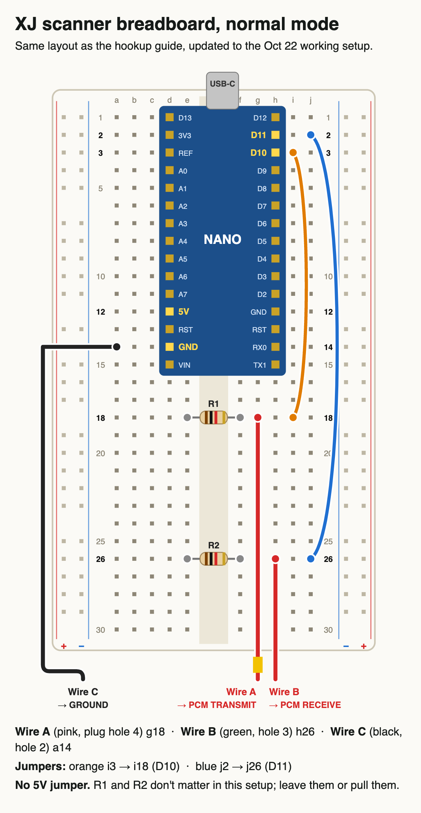

# Wiring

```
laptop ⇄ USB ⇄ Arduino Nano ⇄ 3 wires ⇄ diagnostic plug ⇄ engine computer (PCM)
```

## The three wires (tested, working)

| Wire | Plug cavity | Nano pin | Notes |
|---|---|---|---|
| A | 4 (PCM transmit, ≈0 V key ON) | **D10** | direct, no resistor, no pull-up |
| B | 3 (PCM receive, ≈5 V key ON) | **D11** | direct |
| C | 2 (ground) | **GND** | |

Nothing else is connected. The Nano is powered by USB from the laptop, never from the car.



In the picture: wire A sits in row 18 with an orange jumper from that row to D10, wire B sits in row 26 with a blue jumper to D11, and wire C goes in the Nano's GND row. Any free rows work. Follow the pin labels printed on your own Nano, not the row numbers.

## The resistor question

The first version of this circuit had two 1 kΩ resistors (R1 and R2 in the picture):

- **R1**, a pull-up from D10 to 5 V. **This stopped it working.** The computer's transmit line only pulls down weakly, and a 1 kΩ pull-up held it high, so nothing was ever received. Removing R1 fixed it. The Nano's internal pull-up (the sketch turns it on) is all the line needs.
- **R2**, in series between D11 and wire B. It was bypassed at the same time R1 was removed, and the car has been read that way since. Whether it would also work with R2 left in was not tested.

So the tested setup has **no resistors**. The trade-off: with no series resistor, a wire pushed into the wrong cavity (12 V) goes straight into a Nano pin and can kill it. That is why measuring first matters. If you want protection, try a 470 Ω–1 kΩ resistor in series on wire B and see if it still talks; it is untested on this car.

## Wire length and routing

The test car used 15 ft wires, enough to reach the passenger seat with the laptop. For a permanent install, run the wires through the firewall grommet the factory harness uses and keep the Nano inside the cab. Zip-tie the board down.

## Before it goes on the car (bench checks)

1. Upload the sketch and open the port: the Nano prints `XJBRIDGE 1.0`. With nothing connected, `PROBE` reports `IDLE HIGH% 100`.
2. Continuity: wire A's spade to the D10 pin, wire B's spade to D11, wire C's spade to GND. No continuity between any two wires.
3. With the Nano powered, there must be no 5 V on wire A (if there is, a pull-up is still in the circuit).

## Parts

- Arduino Nano V3 clone (ATmega328P, CH340 USB chip). The test board has USB-C and the *new* bootloader (`cpu=atmega328`); many clones need `cpu=atmega328old`. Try both.
- 400-point breadboard, jumper wires
- 3 × 1/4" male spade terminals, insulated
- About 45 ft of hookup wire in total
- Multimeter
